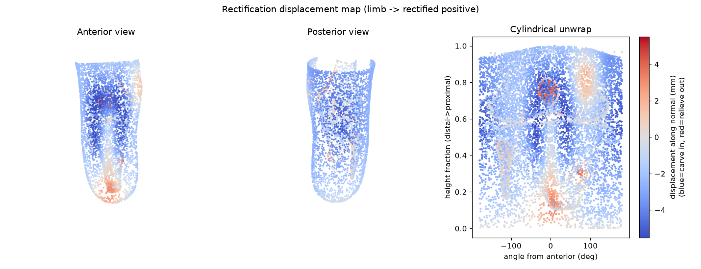

# OpenLimb Socket MVP — Parametric Transtibial Socket Rectification Engine

A working **scan → socket** demo that turns a residual-limb mesh plus a small set
of **clinical-intent** parameters into a watertight, print-ready transtibial
prosthetic **socket STL** — built entirely on **open data** ([OpenLimbTT]) and
**published rectification rules**. No proprietary clinical dataset, no IRB, no
clinic partner required to stand it up.

> ⚠️ **Research/demo prototype only — NOT a cleared medical device.** No claims of
> clinical accuracy, fit, or safety. The attachment interface is a non-engineered
> placeholder, and all biomechanical estimates are approximations. See
> [`docs/LIMITATIONS.md`](docs/LIMITATIONS.md).

This is the deliberate **parametric baseline**: a future *learned* rectification
model must beat it, behind the same `limb mesh + spec -> rectified positive`
contract, and this engine doubles as that model's test harness.

---

## What it does

1. **Limb input** — sample a limb from the [OpenLimbTT] statistical shape model
   (mean / random / single-PC sweep), or upload your own STL/PLY/OBJ.
2. **Rectification** — apply clinical intent (PTB/TSB philosophy, snugness, named
   reliefs & loads, painted custom patches) as a smooth, falloff-weighted
   per-zone displacement plus a global volume reduction → a **rectified positive**.
3. **Socketization** — offset to a uniform wall thickness, cut the trimline, close
   the distal end, add a (placeholder) pylon-adapter boss → a watertight shell.
4. **Verify the design makes sense** (three tiers, increasing fidelity):
   - **Geometry validation** — watertight / manifold / wall-thickness / dimensions.
   - **Design sense-check** — rule-based plausibility audit vs. published practice
     + a fast **interface-pressure proxy** (Winkler elastic-foundation).
   - **In-process FEA** — a real **linear-elastic finite-element** solve for the
     socket–limb interface pressure (OpenLimbTT skin + bone, scipy sparse).
5. **Legibility** — a **displacement heatmap** plus a **Mimics/ScanIP-style
   operation history** so a clinician can *see and audit* every change.
6. **Interfaces** — a single-design *intent → preview → approve → export* page,
   and an **auto-design & compare** page that turns one prompt into three
   candidate sockets with trade-offs.



---

## Quick start

```bash
python -m venv .venv && source .venv/bin/activate
pip install -r requirements.txt

# (recommended) download the real OpenLimbTT shapes (mean limb, PCA modes,
# and the skin + bone surfaces needed for FEA):
python scripts/fetch_openlimb.py
# ^ without this, the engine uses a clearly-labelled SYNTHETIC fallback limb
#   (FEA is unavailable without the bone geometry).

# reproducible end-to-end demo (PTB, TSB, and an atypical custom-relief case):
python scripts/demo.py

# run the in-process linear-elastic FEA from the CLI:
python scripts/run_fea.py --philosophy PTB

# the interactive web app:
uvicorn app.main:app --reload      # open http://127.0.0.1:8000
#   /          single-design intent -> preview -> approve -> export loop
#   /compare   prompt + scan -> AUTO-DESIGN 3 candidate sockets with trade-offs,
#              heatmap / pressure / FEA views, sense-check, sources, op-history
```

### Auto-design & compare (`/compare`)

The visual demo of the whole workflow: type the clinical intent in plain language
(e.g. *"new amputee, oedema, sensitive bony spur"*), pick a scan, and the engine
auto-designs **three candidate sockets** spanning *stability (PTB) ↔ comfort (TSB)*.
Each card has:

- a **3D viewer** with four modes:
  **Heatmap** (rectification: blue = carved in, red = relieved out) ·
  **Pressure\*** (instant Winkler proxy) ·
  **FEA†** (real linear-elastic FEM, run on demand) ·
  **Socket**;
- **trade-off metrics** (volume reduction, snugness, wall thickness, printability)
  and a **Download STL** button;
- a **Design sense-check** panel (pass / warn / fail) — load/offload direction,
  magnitude bounds, volume-reduction band, distal offload, contact, proxy pressure;
- **per-design grounding** citing the specific findings behind *that* design, plus
  a shared **Sources** panel with DOIs;
- a **`✓ computed from model` operation history** — every value reconstructed from
  the pipeline and checked against an independent recomputation in the test suite.

`* Winkler elastic-foundation proxy. † linear-elastic FEM on the OpenLimbTT mean
limb + bone — a small-strain approximation, not an FEA-validated prediction.`

Dump sampled limbs for eyeballing, and run the tests (hermetic — synthetic limb,
no network needed):

```bash
python scripts/dump_limb.py --shape random --seed 3 -o data/out/limb_r3.stl
pytest -q
```

---

## Using it from Python

```python
from socketcad.limb_source import sample_limb
from socketcad.spec import RectificationSpec, CustomReliefRegion
from socketcad.pipeline import run_pipeline

limb, info = sample_limb("mean")                      # or "random" / "synthetic"
spec = RectificationSpec(
    philosophy="PTB", snugness=0.5,
    relieve_fibular_head=True, load_patellar_tendon=True,
    custom_regions=[CustomReliefRegion(point=(x, y, z), radius_mm=18, depth_mm=6)],
)
result = run_pipeline(limb, spec, out_dir="data/out", basename="my_socket")
print(result.validation.passed, result.exports["socket_stl"])

# auto-design 3 candidates from a prompt:
from socketcad.autodesign import build_candidates
candidates, intents = build_candidates("active K3 user, comfortable total contact")

# verify a design makes sense:
from socketcad.sensecheck import sense_check
from socketcad import fea
sc = sense_check(result.rectify, spec)               # audit + pressure proxy
skin, bone = fea.load_openlimb_fea_geometry()        # needs fetch_openlimb
res = fea.run_limb_fea(skin, bone, fea.interference_from_rectify(result.rectify))
print(res.summary())                                 # interface-pressure FEM
```

The rectification step is **swappable**: a future learned model only needs to
implement `rectify(limb_mesh, spec) -> RectifyResult` and the rest of the
pipeline (socketization, validation, sense-check, FEA, UI) is unchanged.

---

## Architecture

```
socketcad/
  geometry.py     anatomical frame estimation, cylindrical coords, falloff, smoothing
  limb_source.py  OpenLimbTT loader (+ welding), synthetic fallback, landmarks
  spec.py         RectificationSpec — the clinical-intent interface (+ defaults)
  autodesign.py   prompt -> 3 candidate designs (transparent rule-based mapping)
  rectify.py      parametric zone-based rectification (the heart; swappable)
  socketize.py    shell offset, trimline, distal end, attachment stub, repair
  validate.py     geometry checks + displacement heatmap (legibility output)
  sensecheck.py   plausibility audit + Winkler interface-pressure proxy
  fea.py          in-process linear-elastic FEM interface-pressure estimate
  processlog.py   Mimics/ScanIP-style operation history (faithful to the pipeline)
  sources.py      centralized citations + grounding note (surfaced in the UI)
  pipeline.py     end-to-end orchestration used by CLI and web app
app/              FastAPI backend + two single-page three.js views
scripts/          fetch_openlimb.py · demo.py · dump_limb.py · run_fea.py
tests/            pytest geometry/pipeline/app/autodesign/fea assertions (hermetic)
docs/             SOURCES.md (provenance) · LIMITATIONS.md (honest caveats)
```

### The clinical-intent interface (the actual differentiator)

The clinician expresses **intent in clinical terms** — not geometry. Vertices,
offsets-in-mm, and mesh ops are never exposed. `RectificationSpec` maps each
clinical control to the underlying transform with literature-grounded defaults:
socket **philosophy** (PTB/TSB), a single **snugness** → volume reduction, named
**reliefs** (fibular head, distal tibial end, tibial crest) and **loads** (patellar
tendon, posterior calf, paratibials), a **custom relief patch** (paint a spot —
for neuromas / scars / bony spurs that templates can't handle), trimline and wall
thickness.

---

## Does the design make sense? (verification ladder)

| Tier | What it checks | Speed | Trust |
|---|---|---|---|
| **Geometry validation** | watertight, manifold, wall thickness, dimensions | instant | a *valid printable object* (not clinical) |
| **Sense-check audit** | load/offload direction, magnitude bounds, VR band, contact — vs. Dickinson 2024 | instant | *design follows published practice* |
| **Pressure proxy** (Winkler) | `p ≈ stiffness × interference`, where pressure concentrates | instant | relative hotspot indicator (illustrative) |
| **Linear-elastic FEA** (`fea.py`) | continuum interface pressure (skin + bone + soft tissue) | seconds | spatial pattern + design ranking; **median/p90 meaningful**, peaks singularity-limited |
| **Nonlinear contact FEA** (FEBio/Abaqus) | validated interface pressure/shear | minutes, external | the rigorous tier — **roadmap** |

The in-process FEA tetrahedralises the OpenLimbTT limb, stiffens the **bone** into
a near-rigid core, imposes the socket's rectification as an inward skin
displacement, and solves linear elasticity for the reaction pressure. It is a
**linear, small-strain proxy** with placeholder material constants — it
discriminates designs sensibly (TSB shows higher total-contact pressure than PTB)
but is **not** a validated clinical prediction. Full caveats in
[`docs/LIMITATIONS.md`](docs/LIMITATIONS.md).

---

## What is real vs. assumed (honest grounding)

This was built "verify, don't assume". Full detail in
[`docs/SOURCES.md`](docs/SOURCES.md); in short:

- **OpenLimbTT is real and used** (verified by cloning [the repo][OpenLimbTT]):
  size-normalised mean mesh + PCA modes over the combined **skin + bone**;
  `vertices = mean + Σ modeᵢ·eigenvalueᵢ`, scaled by intact-tibia length
  (mean 378.52 mm). Data is **CC-BY-SA-4.0** so it is **not vendored** —
  `scripts/fetch_openlimb.py` downloads it. Cite Sunderland et al. (2025).
- **Rectification zones/relationships are real**: the PT/MP/LP/LMC carves and
  FH/TC/DE builds plus gross volume reduction, the PTB>TSB / FH~VR relationships,
  and the bounds (most sockets < 10% VR and < 10 mm distal elongation) come from
  Dickinson et al. (2024, *Frontiers in Rehab. Sci.*, 163 limb/socket pairs).
  Magnitude order-of-magnitude sanity from Convery & Buis (2003).
- **Assumptions are labelled**: exact per-zone median magnitudes were not
  machine-readable from the source, so mid-range values consistent with the
  reported bounds are used and marked as such; FEA material constants are
  literature-level placeholders; the OpenLimbTT `LR.pkl` feasibility regression is
  not applied; landmarking is heuristic. See [`docs/LIMITATIONS.md`](docs/LIMITATIONS.md).

---

## Definition of done (MVP) — status

- [x] OpenLimbTT-sampled **or** uploaded limb → watertight print-ready socket STL
      via clinical-intent controls only, in one session.
- [x] Displacement **heatmap** + auditable **operation history** make it legible.
- [x] At least one **atypical case** (painted custom relief) demonstrated.
- [x] Outputs pass the validation suite (manifold, watertight, wall thickness,
      plausible dimensions).
- [x] **Auto-design & compare** workflow: one prompt → three trade-off designs.
- [x] **Design sense-check** + **in-process linear-elastic FEA** for interface
      pressure (with honest caveats; nonlinear FEBio/Abaqus export as roadmap).
- [x] Docs cover how to run, real-vs-assumed, sources, OpenLimbTT licence /
      attribution, limitations, and the "not a cleared device" disclaimer.

---

## Licence & attribution

Source code: **MIT** (see [`LICENSE`](LICENSE)). OpenLimbTT data: **CC-BY-SA-4.0**
(University of Southampton; not vendored). Required third-party attribution is in
[`NOTICE`](NOTICE). Please cite Sunderland et al. (2025) for OpenLimbTT and
Dickinson et al. (2024) / Convery & Buis (2003) for the rectification
parameterisation. Full citations in [`docs/SOURCES.md`](docs/SOURCES.md).

[OpenLimbTT]: https://github.com/abel-research/OpenLimbTT
